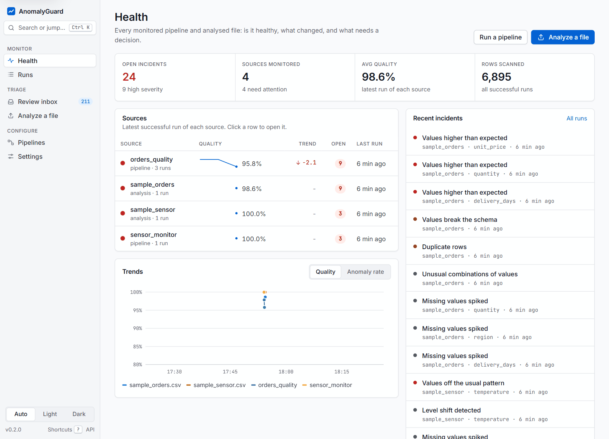
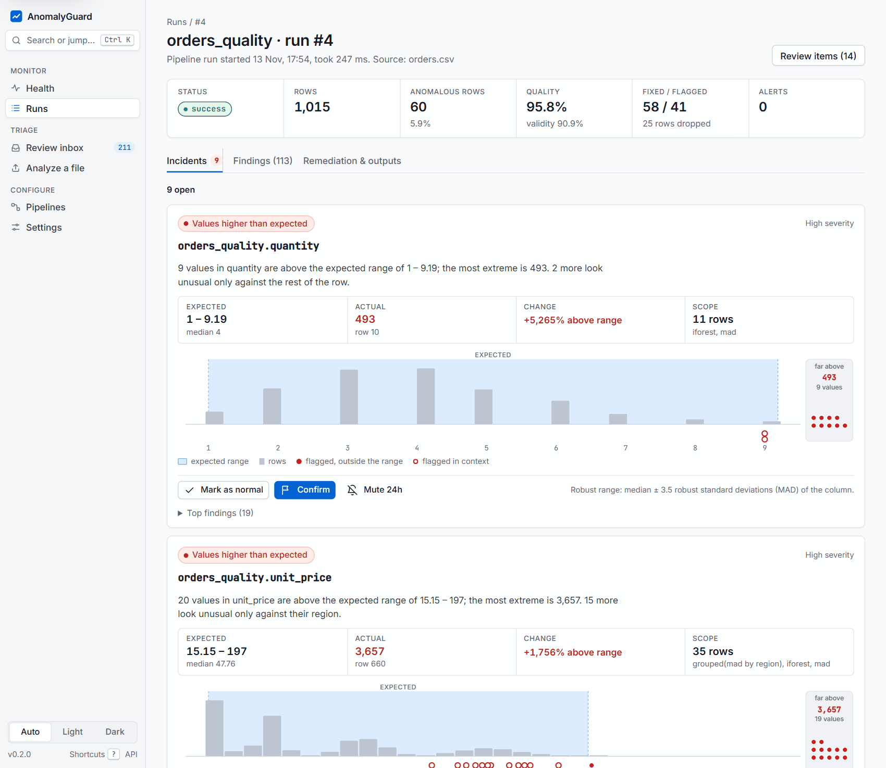
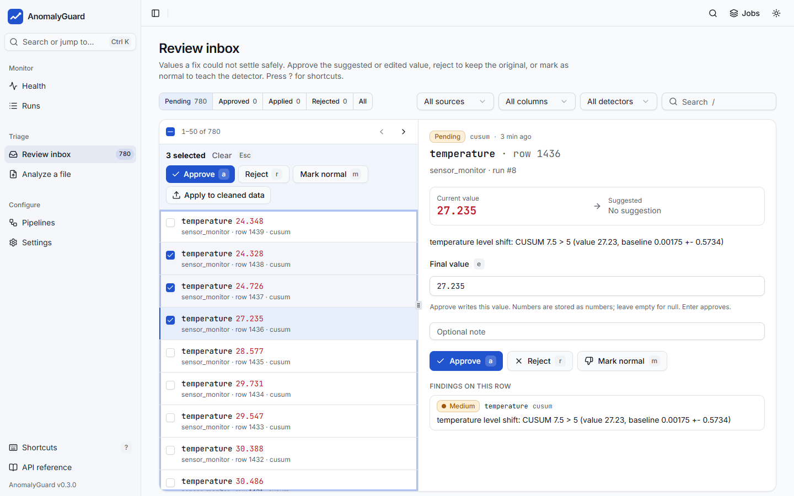
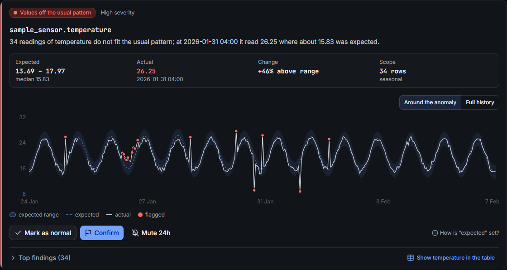
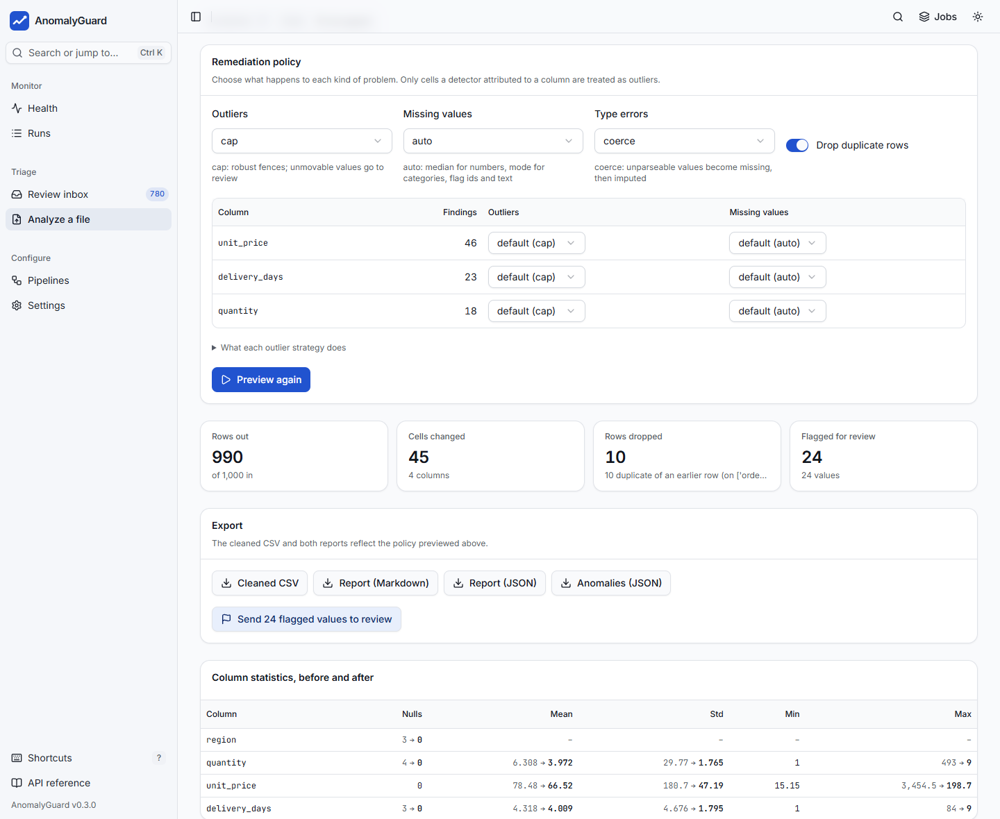
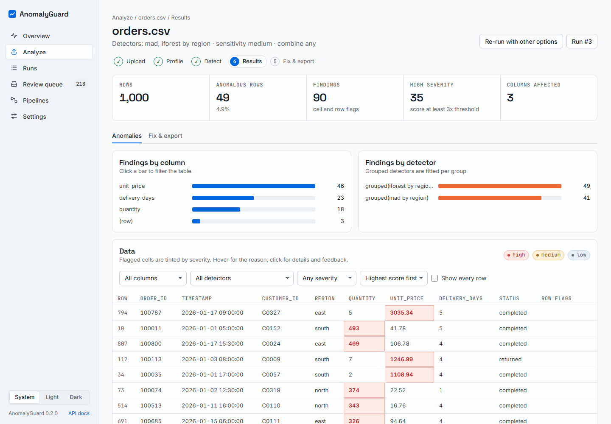
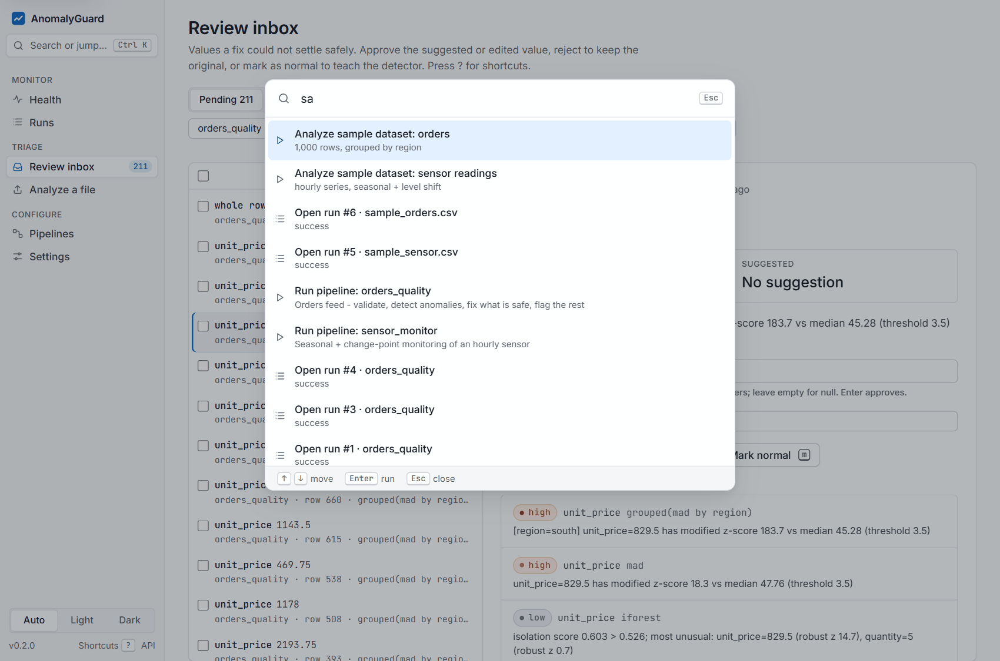

# AnomalyGuard

**Find, explain and fix anomalies in tabular data: a Python library, CLI and web app with detectors written from scratch.**

[](https://github.com/Manas-thakur/anomalyguard/actions/workflows/ci.yml)
[](https://github.com/Manas-thakur/anomalyguard/releases)
[](LICENSE)


**[Website](https://manas-thakur.github.io/anomalyguard/)** ·
**[Documentation](https://manas-thakur.github.io/anomalyguard/docs/introduction/)** ·
**[Quickstart](https://manas-thakur.github.io/anomalyguard/docs/quickstart/)** ·
**[Releases](https://github.com/Manas-thakur/anomalyguard/releases)** ·
**[Changelog](CHANGELOG.md)**



AnomalyGuard reads data from files, databases or APIs, validates it against a schema, finds anomalies with statistical, machine-learning, time-series and contextual detectors, and fixes what is safe to fix. Anything it cannot settle safely goes to a human review queue, and every decision feeds back into detector thresholds. Findings are grouped into **incidents** that say in plain language what happened, show the expected range next to the actual value, and can be triaged in one click. It is one Python package backed by SQLite; the web app ships prebuilt inside it.

## Features

- **Incidents, not walls of findings.** Findings are grouped by source, column and kind (outliers, broken patterns, level shifts, missing values, duplicates, schema violations), each with a plain-language tag, the expected range vs the actual value, and a chart with the expected band shaded. *Mark as normal*, *Confirm* and *Mute 24h* sit on the card.
- **Analyze a file in the browser.** Drop in a CSV, TSV, JSON, JSONL or Parquet file, read the inferred schema, column profiles and quality score, choose detectors, a group-by column and a sensitivity, and browse the data with every anomalous cell highlighted and explained.
- **Preview fixes before you take them.** Choose a strategy per column (cap, winsorize, median, flag, drop, ...), see a before/after diff of every changed cell, then download the cleaned CSV and a Markdown or JSON report.
- **A review inbox that scales.** A keyboard-first split view (`j`/`k`, `a`, `r`, `m`, `e`, `x`), server-side paging and filters, select-all-matching, and bulk approve, reject, apply and mark-as-normal.
- **Declarative pipelines.** YAML pipelines (source, schema, detectors, remediation, alerts, sink, schedule) run from the CLI, on an interval, or from the web app as background jobs.
- **Monitoring and alerts.** Every run is recorded. The Health page shows each source's status, quality trend and open incidents; alert rules notify the console, files, webhooks, Slack or email.
- **Readable, from-scratch algorithms.** Isolation Forest, LOF, k-NN, Grubbs, CUSUM, EWMA and seasonal decomposition in plain NumPy, every flag with a reason such as `[region=east] unit_price=3035 has modified z-score 330.7 vs median 89.08 (threshold 3.5)`.

## Quickstart

```bash
pip install "anomalyguard[server] @ git+https://github.com/Manas-thakur/anomalyguard@v0.3.1"

anomalyguard demo generate -d orders -o orders.csv        # 1,000 synthetic orders with known anomalies
anomalyguard profile orders.csv                            # types, statistics, quality score
anomalyguard detect orders.csv -m mad,iforest --group-by region
anomalyguard fix orders.csv -o orders_clean.csv --group-by region --report fix.md
anomalyguard serve                                         # web app on http://127.0.0.1:8765
```

`detect` prints the most anomalous rows with their reasons:

```
Scanned 1000 rows: 49 anomalous (4.9%), combine=any
By detector: grouped(mad by region)=41, grouped(iforest by region)=49
By column:   (row)=3, delivery_days=13, quantity=10, unit_price=23

Top 10 anomalies (highest score first):
  row 794  score=94.47  votes=2  columns=unit_price
      - [region=east] unit_price=3035 has modified z-score 330.7 vs median 89.08 (threshold 3.5)
      - [region=east] isolation score 0.787 > 0.500; most unusual: unit_price=3035 (robust z 330.9), quantity=5 (robust z 0.7)
  ...
```

In the web app, **Analyze a file** walks through the same steps; the command palette (<kbd>Ctrl</kbd>/<kbd>Cmd</kbd>+<kbd>K</kbd>) can analyze either sample dataset in one step. The [Quickstart](https://manas-thakur.github.io/anomalyguard/docs/quickstart/) goes further.

## Installation

Requires Python 3.10 or newer.

AnomalyGuard is installed from GitHub (it is not on PyPI). These commands install the v0.3.0 release; replace `@v0.3.1` with `@main` for the latest code.

```bash
# library + CLI
pip install "anomalyguard @ git+https://github.com/Manas-thakur/anomalyguard@v0.3.1"

# with the web app, Parquet and SQLAlchemy (PostgreSQL/MySQL/...) support
pip install "anomalyguard[all] @ git+https://github.com/Manas-thakur/anomalyguard@v0.3.1"

# uv
uv tool install "anomalyguard[server] @ git+https://github.com/Manas-thakur/anomalyguard@v0.3.1"

# container image (web app on http://localhost:8765); the volume keeps the database,
# uploads and pipelines created in the web app
docker run --rm -p 8765:8765 -v "$PWD/.anomalyguard:/data/.anomalyguard" ghcr.io/manas-thakur/anomalyguard
```

| Extra | Adds | Needed for |
|---|---|---|
| `server` | fastapi, uvicorn, python-multipart | `anomalyguard serve` (web app + REST API, uploads) |
| `parquet` | pyarrow | Parquet sources, sinks and uploads |
| `sql` | sqlalchemy | non-SQLite databases (SQLite works without it) |
| `all` | all of the above | |

The web app is prebuilt into the package, so no Node.js is needed to install or run it. More in [Installation](https://manas-thakur.github.io/anomalyguard/docs/installation/).

## Usage

### Web app

`anomalyguard serve` starts the web app and the REST API. It follows the system light or dark theme, works down to phone width, and can be driven from the keyboard (<kbd>?</kbd> lists the shortcuts).

| Page | What you can do |
|---|---|
| **Health** | Open incidents, sources monitored, average quality and rows scanned; one row per pipeline or analysed file with a status dot, quality sparkline, trend and open incidents; a feed of recent incidents; quality and anomaly-rate trends |
| **Runs** | Every run and analysis, filterable. A run opens on its incidents; the sortable findings table, remediation, alerts and downloads are in the other tabs |
| **Review inbox** | Split view with keyboard triage, a bulk bar and select-all-matching; a bottom sheet on phones |
| **Analyze** | Upload or pick a sample → profile → detectors, group-by and sensitivity → incidents and the highlighted data → fix & export |
| **Pipelines** | List pipeline YAML files, edit and validate them, run one now as a background job, create one from a template |
| **Settings** | Detector threshold multipliers (edit, reset, tune from feedback), API key status, notifiers, extras and environment |

| Incident with its expected band | Review inbox |
|---|---|
|  |  |
| **Time-series incident (dark theme)** | **Fix & export** |
|  |  |
| **Analysis results** | **Command palette** |
|  |  |

The [web app guide](https://manas-thakur.github.io/anomalyguard/docs/guides/web-app/) covers every page.

### CLI

| Command | What it does |
|---|---|
| `anomalyguard profile FILE` | Infer a schema, profile columns, compute completeness, validity, uniqueness, freshness and a quality score |
| `anomalyguard validate FILE --schema schema.yaml` | Validate against a schema; exits 1 if a rule fails |
| `anomalyguard detect FILE [-m mad,iforest] [--group-by col] [--time-column ts] [--combine any\|vote\|all]` | Detect anomalies and print the top rows with reasons |
| `anomalyguard fix FILE -o clean.csv [--outlier cap] [--missing auto] [--report fix.md]` | Detect and remediate, then write the cleaned data and a report |
| `anomalyguard run PIPELINE.yaml [--schedule \| --every 5m]` | Run pipelines once or on an interval |
| `anomalyguard init [-t csv_quality\|timeseries_monitor\|database_quality]` | Write a starter pipeline |
| `anomalyguard serve [--port 8765] [--pipeline-dir DIR]` | Web app and REST API |
| `anomalyguard demo generate \| benchmark` | Synthetic labelled data; precision, recall, F1 and ROC-AUC of every detector |
| `anomalyguard review`, `feedback`, `detectors`, `doctor` | Review queue, feedback and threshold tuning, detector list, environment check |

Every command and flag is in the [CLI reference](https://manas-thakur.github.io/anomalyguard/docs/reference/cli/). `python -m anomalyguard` works too.

### Python

```python
import anomalyguard as ag
from anomalyguard.detect import GroupedDetector, IsolationForestDetector, MADDetector, run_detectors
from anomalyguard.remediate import RemediationPipeline

df = ag.read("examples/data/orders.csv")
print(ag.profile(df).quality.score)

report = ag.detect(df, ["mad", "iforest"], group_by="region")
for rec in report.records(limit=3):
    print(rec["index"], rec["score"], rec["reasons"])

result = ag.fix(df)  # dedupe, type fixes, impute, cap outliers, flag the rest
result.data.to_csv("clean.csv", index=False)

# full control
cols = ["quantity", "unit_price", "delivery_days"]
report = run_detectors(
    df,
    [
        MADDetector(columns=cols),
        GroupedDetector(MADDetector(columns=["unit_price"]), group_by="region"),
        IsolationForestDetector(columns=cols, n_estimators=200),
    ],
)
policy = {
    "default": {"missing": "auto", "outlier": "cap"},
    "columns": {"unit_price": {"outlier": "flag"}},
}
result = RemediationPipeline(policy).run(df, report)
```

Every detector has `fit`, `score`, `predict` and `detect`. See the [Python API](https://manas-thakur.github.io/anomalyguard/docs/reference/python-api/) and [`examples/api_example.py`](examples/api_example.py).

### Pipeline YAML

```yaml
name: orders_quality
source:
  type: csv
  path: data/orders.csv            # paths are relative to this file
schema:
  path: orders.schema.yaml         # loaded if present, otherwise inferred and saved
detectors:
  - method: mad
    columns: [quantity, unit_price, delivery_days]
  - method: mad
    columns: [unit_price]
    group_by: region               # contextual anomalies: fitted per region
  - method: iforest
detection:
  combine: any                     # any | vote | all
remediation:
  dedupe: true
  default: {missing: auto, outlier: cap, invalid: coerce}
  columns:
    unit_price: {outlier: flag}    # send to review instead of capping
alerts:
  rules:
    - {metric: anomaly_rate, op: ">", value: 0.03, severity: warning}
    - {metric: quality_score, op: "<", value: 0.95, severity: error}
  notifiers:
    - {type: console}
    - {type: file, path: out/alerts.jsonl}
    # - {type: slack, url: "${SLACK_WEBHOOK_URL}", min_severity: error}
sink:
  path: out/orders_clean.csv
  report_path: out/remediation.md
schedule:
  every: 1h                        # used by `anomalyguard run --schedule`
```

```bash
anomalyguard run examples/pipeline.yaml
anomalyguard run examples/pipeline.yaml --schedule
```

`${VAR}` and `${VAR:-default}` are replaced from the environment. In pipelines, `detection.min_votes` defaults to 1; on the CLI and in web analyses `vote` needs 2 detectors. Every key is in the [pipeline YAML reference](https://manas-thakur.github.io/anomalyguard/docs/reference/pipeline-yaml/).

## Detectors

| Name | Category | How it works | Default threshold |
|---|---|---|---|
| `zscore` | statistical | `abs(x - mean) / std` per column | 3.0 |
| `mad` | statistical | Modified z-score `0.6745 * abs(x - median) / MAD`; robust to contamination | 3.5 |
| `iqr` | statistical | Tukey fences: distance outside [Q1, Q3] in IQR units | 1.5 |
| `grubbs` | statistical | Iterative two-sided Grubbs test | alpha = 0.05 |
| `iforest` | ML | Isolation Forest (random isolation trees, `2^(-E[h]/c(n))`) | auto: median + 4 MAD of training scores (min 0.5) |
| `lof` | ML | Local Outlier Factor (reachability distance, local density) | auto: median + 6 MAD (min 1.2) |
| `knn` | ML | Mean distance to the k nearest neighbours in robust-scaled space | auto: median + 6 MAD |
| `rolling_zscore` | time series | Deviation from a trailing window (rolling median/IQR, or mean/std) | 4.0, window 24 |
| `ewma` | time series | Residual from an EWMA forecast; spikes are clipped before the state updates | 4.0, span 24 |
| `seasonal` | time series | Robust trend + per-phase seasonal profile, robust z of the residual | 4.0, period 24 |
| `cusum` | time series | Two-sided tabular CUSUM on robust-standardised values | h = 5, k = 1.0 |
| `flatline` | time series | Runs of identical consecutive values (stuck sensor, frozen feed) | learned run length (min 5) |
| `grouped` | contextual | Any detector fitted separately per group (`group_by`) | per base detector |
| `ensemble` | ensemble | `mean`, `max` or `weighted` of normalised scores, or `vote` with `min_votes` | 1.0 normalised |

Every raw score is divided by its threshold, so a normalised score above 1.0 always means anomalous. The statistical detectors score positive, right-skewed columns (amounts, latencies) on a log scale (`log_scale: false` or `--no-log-scale` to turn it off). With a time column, time-series detectors run on a regular time grid, so gaps do not shift seasonal phases. On the CLI, `--param DETECTOR.KEY=VALUE` sets any parameter (`--param seasonal.period=168`). Parameters and guidance on when to use each detector are in the [detector reference](https://manas-thakur.github.io/anomalyguard/docs/reference/detectors/).

## Benchmarks

Real output of `anomalyguard demo benchmark` (seed 42) on three synthetic datasets with ground-truth labels, each detector at its default threshold. The best detector per dataset, next to a global `mad` baseline:

| Dataset | What is in it | Best detector | Precision | Recall | F1 | ROC-AUC | `mad` F1 |
|---|---|---|---|---|---|---|---|
| tabular | 2,000 rows of correlated 6-D data; point and broken-correlation anomalies | `lof` | 0.81 | 0.88 | 0.84 | 0.975 | 0.65 |
| orders | 2,000 orders; point anomalies and west-region prices on other regions' orders | `mad` by region | 0.81 | 1.00 | 0.90 | 1.000 | 0.63 |
| sensor | 1,440 hourly readings with a daily cycle; spikes, night-time peaks, level shifts, drift | `ensemble` max(seasonal + cusum) | 0.89 | 0.99 | 0.94 | 0.997 | 0.00 |

Univariate detectors catch extreme values but not broken correlations (LOF and k-NN do); global detectors miss contextual anomalies that per-group detection catches; on seasonal series the seasonal residual catches spikes and CUSUM catches sustained shifts. These are synthetic datasets built to exercise each anomaly type, so they don't tell you how the detectors will do on your data. Full tables: [Benchmarks](https://manas-thakur.github.io/anomalyguard/docs/benchmarks/). Reproduce with `anomalyguard demo benchmark`.

## Configuration

| Setting | Default |
|---|---|
| State directory (metrics DB, review queue, jobs, uploads, analyses, checkpoints) | `./.anomalyguard/` (`serve --db`, `monitor.db` and `state.dir` in a pipeline) |
| `ANOMALYGUARD_API_KEY`: key every `/api/*` request must send (`X-API-Key` or `Authorization: Bearer`) | unset: no key |
| `ANOMALYGUARD_CORS_ORIGINS`: origins allowed to call the API from other sites | unset: same origin only |
| `ANOMALYGUARD_MAX_UPLOAD_MB`: largest upload (or `serve --max-upload-mb`) | `100` |
| `ANOMALYGUARD_PIPELINE_DIRS`: folders scanned for pipeline YAML (or `serve --pipeline-dir`) | `pipelines,examples` |
| `ANOMALYGUARD_WORKERS`: background job threads | `2` |
| `ANOMALYGUARD_SMTP_PASSWORD`, `OPENAI_API_KEY`, `${VAR}` in YAML | notifier and LLM secrets |

With a key set, `/health`, `/api/auth` and the web app's pages stay open; everything under `/api/` (including `/api/docs`) needs the key. `anomalyguard doctor` checks the state directory, extras, pipeline files and notifier secrets. Details: [Configuration](https://manas-thakur.github.io/anomalyguard/docs/reference/configuration/) and [Deployment](https://manas-thakur.github.io/anomalyguard/docs/guides/deployment/). The OpenAPI docs are served at `/api/docs`, and every endpoint is in the [HTTP API reference](https://manas-thakur.github.io/anomalyguard/docs/reference/http-api/).

## Architecture

```
Sources: CSV/TSV, JSON/JSONL, Parquet, SQLite/SQL, REST API, in-memory streams
    |
ingest     connectors, schema inference, checkpoints + watermark (incremental reads)
    |
schema     registry (YAML/JSON), validation, type coercion, quality score
    |
detect     statistical | ML (from scratch) | time-series | grouped | ensemble  -> reasons
    |
remediate  dedupe, type fixes, impute, cap/winsorize/clip, drop, flag -> review queue (+ optional LLM)
    |
alert      rules on run metrics -> console, JSONL file, webhook, Slack, email (rate-limited)
    |
monitor    SQLite metrics store, incidents, FastAPI + web app, background jobs, feedback -> thresholds
```

```
src/anomalyguard/   ingest/ schema/ detect/ remediate/ alert/ monitor/ pipeline/ demo/, api.py, cli.py
  monitor/static/   the built web app (generated from web/, committed)
web/                React 19 + TypeScript + Vite + Tailwind CSS v4 + shadcn/ui source of the web app
site/               Astro + Starlight landing page and documentation
examples/           sample data, pipelines, schema and a Python walkthrough
tests/              pytest suite (offline)
plans/              the original design documents
```

The UI design references and the reasons for the component kit are in [docs/design/references.md](docs/design/references.md).

## Development

```bash
git clone https://github.com/Manas-thakur/anomalyguard && cd anomalyguard

# Python: library, CLI, API
uv sync --all-extras
uv run pytest -q
uv run ruff check . && uv run ruff format --check .

# Web app (Node 24, pnpm 10)
cd web
pnpm install
AG_API=http://127.0.0.1:8765 pnpm dev   # Vite dev server; proxies /api to a running `anomalyguard serve`
pnpm typecheck && pnpm lint && pnpm test
pnpm build                               # writes src/anomalyguard/monitor/static/ (commit the result)

# Documentation site
cd ../site
pnpm install
pnpm dev                                 # or `pnpm build` (fails on broken internal links)
```

CI runs ruff, pytest and a CLI smoke test on Python 3.10 to 3.12, type-checks, lints, tests and builds the web app and fails if the committed build is out of date, checks that the wheel ships the web app, and builds the Docker image. Releases are cut by pushing a `vX.Y.Z` tag; see [CONTRIBUTING.md](CONTRIBUTING.md).

## Roadmap

The design documents in [`plans/`](plans/) are broader than this release. Not built yet: Kafka and file-watch sources; One-Class SVM, autoencoder, DBSCAN, Holt-Winters, ARIMA and PELT detectors; model-based imputation; compound and freshness alert rules; PostgreSQL metrics storage; cron schedules; user accounts and roles in the web app (it has one shared API key) and scheduling from the UI (pipelines run on demand there; schedules need `anomalyguard run --schedule`). Uploaded files are analysed in memory.

## Contributing

Issues and pull requests are welcome. [CONTRIBUTING.md](CONTRIBUTING.md) covers the setup, the checks to run and how the web build is kept in sync.

## License

MIT © 2026 Manas Thakur. See [LICENSE](LICENSE).
